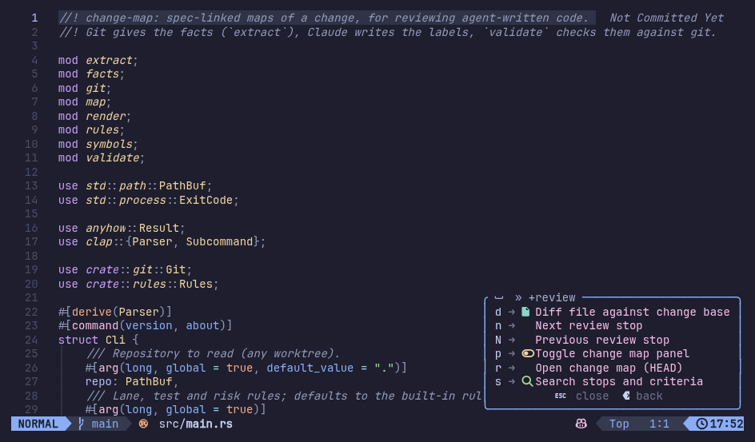

# change-map

Review agent-written code in Neovim without reading the diff line by line and without knowing the codebase. A change map gives you three things:

1. The spec mapped to code: criteria marked ✓ implemented and tested, ⚠ untested or partial, ✗ missing. Each criterion links to the code that implements it and to the tests that prove it.
2. Where the change sits: changed symbols grouped by lane (ui, api, services, db, engine, jobs, other), with edges between them.
3. A reading order: 8–15 tour stops, with a one-line caption above every place the change touches.

**The map is facts, the labels are help.** Git and tree-sitter give the structure. The Claude session that runs the skill writes the labels. `change-map validate` checks those labels against git.

| Computed by the `change-map` binary | Written by Claude (the `change-map` skill) |
| --- | --- |
| Changed hunks outside test files, each split at its enclosing function, class, type or const (tree-sitter: TypeScript, TSX, Rust; other files map to whole-file nodes) | Criteria from the spec and the PR, with `status` and `specRef` |
| Lane and risk (`read` or `skim`) from `rules.json`; comment-only hunks (every changed line inside comment nodes, by tree-sitter, on both sides) are `skim` | Groups: the same edit at N places becomes one node with N sites, and imports and types fold into the function they serve |
| `calls` edges: a changed symbol names a changed exported symbol that its file imports | One-line captions |
| `touchedByTest` hint: a changed test file references the node's exported symbol (`git grep -w`) | The tour (reading order) |
| Test declarations (`test(`, `it(`, `describe(`, `.only`/`.skip`, `test.for(…)(`/`test.each(…)(`, `fooTest(` fixtures, `#[test]`) in changed test files | Per criterion, the `tests` that prove it; empty means untested |

Tests never become nodes. A criterion is tested only when it names tests, and `validate` checks that each one is a real test declaration at that line. In Rust, an inline `mod tests` counts as tests.

## Layout

| Path | What |
| --- | --- |
| `src/map.rs` | The convention as serde types (`deny_unknown_fields`). `schema/change-map.schema.json` is generated from them with schemars; a unit test fails if it is stale (`UPDATE_SCHEMA=1 cargo test` rewrites it). |
| `src/` | The `change-map` binary: `extract`, `validate`, `render`, `path` |
| `rules.json` | Lane, test and risk rules, built into the binary. Override them with `--rules <file>`. |
| `skill/SKILL.md` | The skill. Install it with `ln -s ~/dev/change-map/skill ~/.claude/skills/change-map` |
| `lua/`, `plugin/` | The Neovim plugin |

```sh
cargo build --release        # → target/release/change-map
change-map extract --base <sha> [--spec spec.md]   # facts + draft map → <store>/<head>.facts.json
change-map validate <map.json>                     # exit 1 with one line per problem
change-map render <map.json>                       # → <map>.md: criteria, tour, mermaid
change-map path                                    # → <git-common-dir>/change-map/<HEAD sha>.json
```

`validate` deserializes the map, which checks the schema. It then checks that:

- every site starts and ends on changed lines;
- every added line of a non-test file is inside exactly one node's sites, every deleted non-test file is in exactly one node's `deletions`, and every listed move is in exactly one node's `renames`. Listed moves are pure renames (no hunks) touching a non-test path, and any move of a non-test file into a test path;
- the tour lists every node once;
- every criterion and edge id exists;
- each criterion test is a test declaration with that name, at that line, at head;
- the `touchedByTest` hints match what changed test files reference;
- comment-only nodes link no criterion;
- every `specRef` heading exists in the spec.

`validate` checks that `base` and `head` are full shas of commits before any other git call. Every revision argument goes after `--end-of-options`, so an option-like value can't become a git flag. Submodule pointer changes (gitlinks) are skipped and listed.

The binary reads git output as bytes. Paths must be exact UTF-8; quoted and octal-escaped names are decoded, and a file with a non-UTF-8 path is skipped and listed. Diff content is decoded lossily, so one bad byte never drops a file. Every git call forces `core.quotePath=false`, `diff.noprefix=false`, `diff.mnemonicPrefix=false`, `diff.interHunkContext=0`, `diff.relative=false` and `color.ui=false`, and diffs run with `-U0 --no-color --no-ext-diff --no-textconv`, so user config does not change the facts.

The store is `$(git rev-parse --git-common-dir)/change-map`, so every worktree of a repo shares it and a map never lands in the working tree. The binary only shells out to `git`. It makes no LLM or LSP calls.

## Install (LazyVim)

```lua
-- ~/.config/nvim/lua/plugins/change-map.lua
return {
  {
    dir = "~/dev/change-map",
    cmd = { "ChangeMap", "ChangeMapPanel", "ChangeMapDiff" },
    keys = {
      { "<leader>rr", function() if require("change-map").load("") then require("change-map").panel() end end, desc = "Open change map (HEAD)" },
      { "<leader>rp", function() if require("change-map").ensure() then require("change-map").toggle_panel() end end, desc = "Toggle change map panel" },
      { "<leader>rd", function() if require("change-map").ensure() then require("change-map").diff() end end, desc = "Diff file against change base" },
      { "<leader>rs", function() if require("change-map").ensure() then require("change-map").panel({ focus = "input" }) end end, desc = "Search stops and criteria" },
      { "<leader>rn", function() require("change-map").stop(1) end, desc = "Next review stop" },
      { "<leader>rN", function() require("change-map").stop(-1) end, desc = "Previous review stop" },
    },
  },
  { "folke/which-key.nvim", optional = true, opts = { spec = { { "<leader>r", group = "review" } } } },
}
```

## Workflow

1. In Claude Code, inside the repo with the PR checked out, ask: "make a change map for this PR". The skill finds the base, runs `extract`, fills in the map, runs `validate` until it passes, and runs `render`.
2. In nvim, in the same repo, press `<leader>rr`. This loads the map for HEAD into the quickfix list and the captions, and opens the panel.

Press `<leader>r` and which-key lists every review key:



| Key | Command | What |
| --- | --- | --- |
| `<leader>rr` | `:ChangeMap` + `:ChangeMapPanel` | Load the map for HEAD (`:ChangeMap path/to/map.json` also works) and open the panel |
| `<leader>rp` | `:ChangeMapPanel` | Toggle the panel |
| `<leader>rs` | | Panel with the cursor in the search input; typing filters stops and criteria |
| `<leader>rn` / `<leader>rN` | `]q` / `[q` | Next/previous tour stop |
| `]x` / `[x` | | Next/previous site of the current stop, across files (buffer-local, only where a map has sites; `]s`/`[s` stay Vim's spelling jumps) |
| `<leader>rd` | `:ChangeMapDiff` | Current file against base (gitsigns `diffthis` + `change_base`, else `:diffsplit`) |

The panel is a snacks picker set up like the snacks explorer: a tree of Spec → criteria → stops, then Lanes → stops → sites and edges, then Unexplained. Each criterion also lists its tests; `<CR>` on a test opens it.

- `<CR>` or `l` on a folder folds or unfolds it. `h` closes the folder.
- `<CR>` on a stop or a site jumps to the code and sets the quickfix index.
- `P` or `<a-p>` toggles the preview.

Deleted files show as `✗ deleted <path>` under their stop, with no jump. Moves show as `→ moved from <from>` and open the new path. A stop that only deletes files gets a text-only quickfix entry.

Without snacks, the panel is a plain buffer with the same sections. Every site gets a caption line above it. The first site shows `n/N · lane · risk · REF-x · caption`. The other sites show `n/N · site k/K · symbol`.

## Known limits

- Edges use name matching between changed symbols. A call from unchanged code is not shown, and there is no LSP call hierarchy yet.
- `touchedByTest` only means a changed test file names the symbol, so the panel and the captions don't show it as a test status. The criterion `tests` are what count, and the skill must read each test before listing it.
- Risk is keyword-based. Tune `readKeywords` in `rules.json`.
