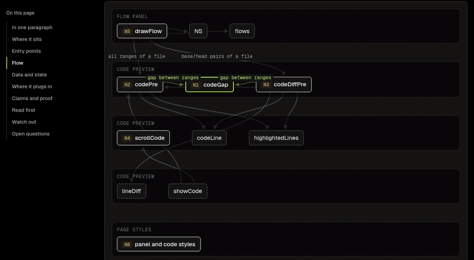

# overview-me

Review a PR with the code and its flow side by side.

overview-me is a set of agent skills for [Claude Code](https://claude.com/claude-code) and [pi](https://pi.dev). Ask your agent about a PR, your uncommitted changes or a whole codebase, and it writes a one-page overview you can click through.



## Why I made this

Reviewing code is hard. It is harder when you don't know the codebase.

**The code is far from the explanation.** Ask Claude to explain a PR and you get paths to the code, not the code. To read each one, you open another browser tab, find the line, then come back. overview-me puts the code next to the explanation: click a box in the flow, or the eye icon next to any `path:line`, and the code opens in a side panel. No tab switching. The Before and After flows have separate panels, so you can keep both open. In a changed Before box, **Preview diff** shows what the branch changed.

**A big PR doesn't fit in your head.** Halfway through, you forget where you came from and how the parts connect. The flow keeps the whole change on screen: how the code ran before, how it runs now, and which box the code you are reading belongs to.

**The facts must be right.** A CLI reads git and parses the code, so the same diff always gives the same map. Claude only writes the labels, and the CLI rejects the map until every changed line is in it and every cited test exists.

The [tutorial](docs/tutorial.md) walks through every feature with screenshots.

## Install

In Claude Code:

```
/plugin marketplace add CaoKha/overview-me
/plugin install overview-me@overview-me
```

In pi, in a terminal:

```sh
pi install git:github.com/CaoKha/overview-me
```

The first time a skill runs in pi, it downloads the CLI for your machine.

## Use

Ask in plain words, or run the command:

| Ask | Claude Code | pi | You get |
| --- | --- | --- | --- |
| "PR overview", "explain PR 3389" | `/overview-me:pr-overview` | `/skill:pr-overview` | the overview of the PR checked out |
| "overview of my changes" | `/overview-me:change-overview` | `/skill:change-overview` | the same, for your uncommitted files |
| "explain this codebase" | `/overview-me:codebase-overview` | `/skill:codebase-overview` | a map of the repo; PR overviews use it to place a change |
| "show the bugs in this PR on the flow" | `/overview-me:ocr-overview` | `/skill:ocr-overview` | the PR overview with [OpenCodeReview](https://github.com/alibaba/open-code-review) findings on the flow boxes |

In Claude Code the overview opens as a private Claude artifact; in pi and other agents it opens as an HTML file in your browser.

The findings skill needs the `ocr` CLI. See [how to read findings on the flow](docs/tutorial.md#6-read-findings-on-the-flow).

## Update

In Claude Code, in a terminal:

```sh
claude plugin marketplace update overview-me
claude plugin update overview-me@overview-me
```

The first command fetches the latest list of versions; the second installs the newest one. Then start a new Claude Code session: the new skills load, and the session downloads the CLI for the new version.

To update automatically, run `/plugin` in Claude Code, open the overview-me marketplace, and turn on auto-update.

In pi, run `pi update --extensions`. The next skill run downloads the CLI for the new version.

## Contribute

Working on overview-me itself? See [CONTRIBUTING.md](CONTRIBUTING.md).
