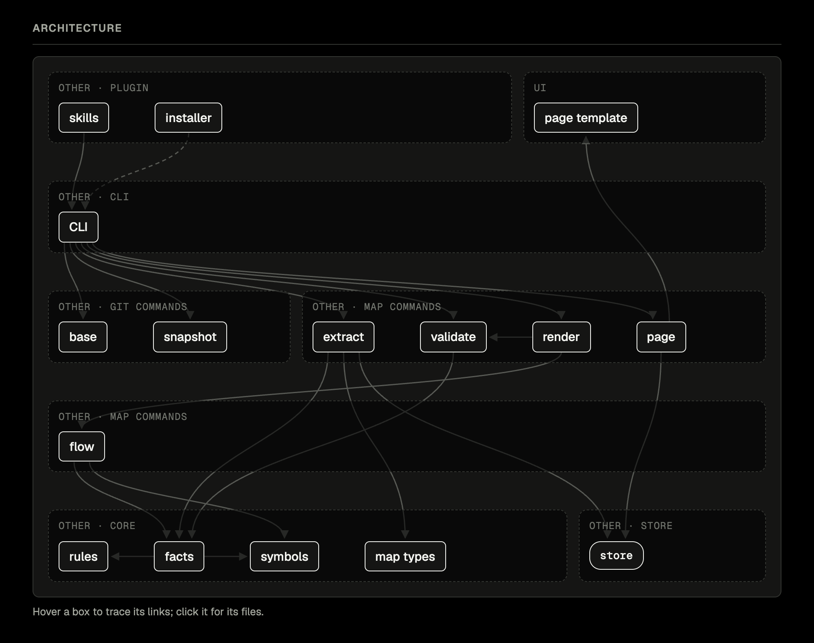
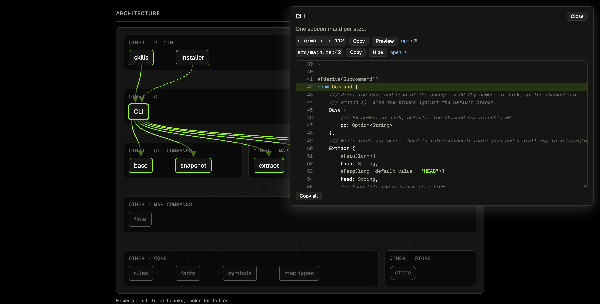
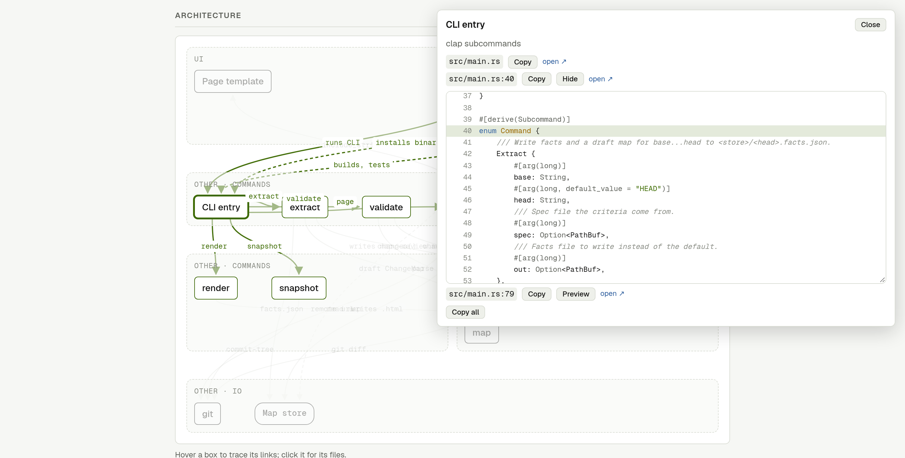
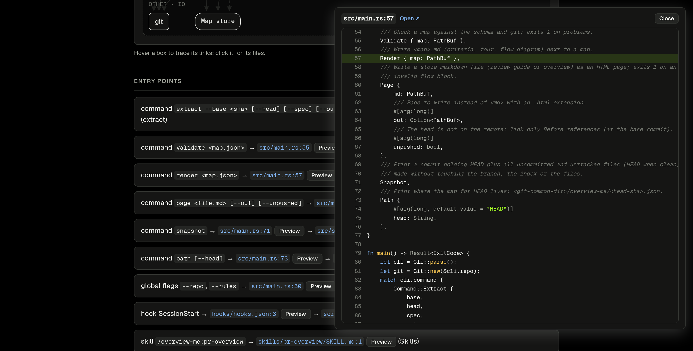
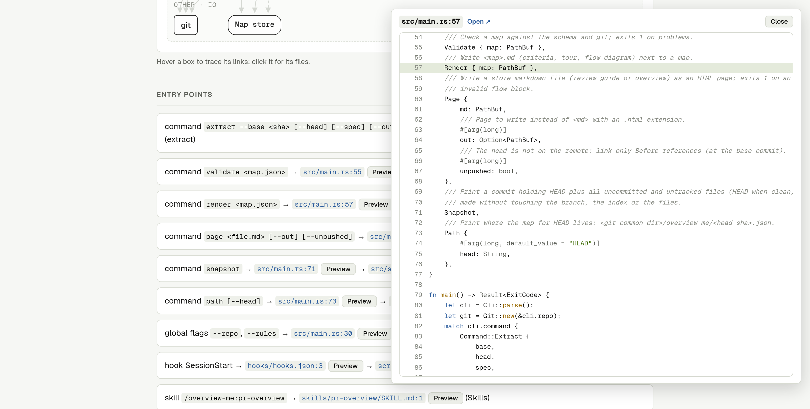

# overview-me

Understand a code change in five minutes instead of reading the diff line by line.

overview-me is a Claude Code plugin. Ask Claude about a PR, your uncommitted changes or a whole codebase, and it writes a one-page overview: what the change does, how the code flows before and after it, which tests prove each claim, which few places to read first, and what is easy to miss (breaking changes, races, migrations and the like). Every claim points to `path:line`, and the change map behind it is checked against git.

## Why not just ask Claude?

You can ask any agent to "explain this PR", with or without a skill. The answer changes from run to run: the agent may read different files, skip a changed file it never opened, cite a line that moved, or say a test proves something it doesn't. A skill is only instructions, and the model follows them more or less closely each time.

Most of that work doesn't need an agent anyway. Listing changed lines, tracking moves, finding callers and checking that a test exists are mechanical jobs. A program does them the same way every time, and it is never wrong about what git says. So overview-me follows one rule: **if a tool can do the job, a tool does it. The agent only does what needs judgment.**

- **The tool gets the facts.** A small CLI reads git and parses the code with tree-sitter. It finds the changed lines, the moved and deleted files, and which functions call which. The same diff always gives the same map.
- **The agent writes the labels.** Claude adds what a program can't: the criteria, the captions, the groups and the reading order.
- **The tool checks the agent.** `overview-me validate` rejects the map if a changed line, deleted file or move doesn't belong to exactly one stop. It also rejects a test cited as proof that isn't a real test at that line. Claude must fix the map until it passes, and only then writes the overview.
- **Fixed rules decide the grouping.** Lanes, test paths and risk keywords come from `rules.json`, so a file lands in the same place on every run.
- **One map per commit.** The map is saved under the commit's SHA and reused, so asking again about the same commit gives the same structure.

The wording still changes between runs, but the facts don't. Nothing in the diff is skipped without a word, and every `path:line` points to real code.

## Install

In Claude Code:

```
/plugin marketplace add CaoKha/overview-me
/plugin install overview-me@overview-me
```

## Update

### Manually

In a terminal:

```sh
claude plugin marketplace update overview-me
claude plugin update overview-me@overview-me
```

The first command fetches the latest list of versions; the second installs the newest one. Then start a new Claude Code session: the new skills load, and the session downloads the CLI for the new version.

### Automatically

Run `/plugin` in Claude Code, open the overview-me marketplace, and turn on auto-update. Claude Code then installs new versions for you; the next session after an update downloads the new CLI.

## Use

Ask in plain words, or run the command:

| Ask | Command | You get |
| --- | --- | --- |
| "PR overview", "explain PR 3389" | `/overview-me:pr-overview` | the overview of the PR checked out |
| "overview of my changes" | `/overview-me:change-overview` | the same, for your uncommitted files |
| "explain this codebase" | `/overview-me:codebase-overview` | a map of the repo; PR overviews use it to place a change |

The result opens as a page. Hover a box in a flow diagram to trace its links, click it to copy its file paths into your editor, and preview any `path:line` in the page or follow it to the code. A preview highlights the boxes that hold that code, with a link to each.

This is the architecture diagram from the codebase overview of overview-me itself. Each box is a module, and each arrow shows which module calls which:



Click a box to open its side panel with the box's note and the files to copy, preview or open. Preview shows the file inside the panel, scrolled to the cited line. The box's links stay highlighted:

| Dark | Light |
| --- | --- |
|  |  |

Every `path:line` in the text has a Preview button too. It opens the whole file in a panel you can move and resize, with syntax colors and the cited lines highlighted:

| Dark | Light |
| --- | --- |
|  |  |

Working on overview-me itself? See [CONTRIBUTING.md](CONTRIBUTING.md).
