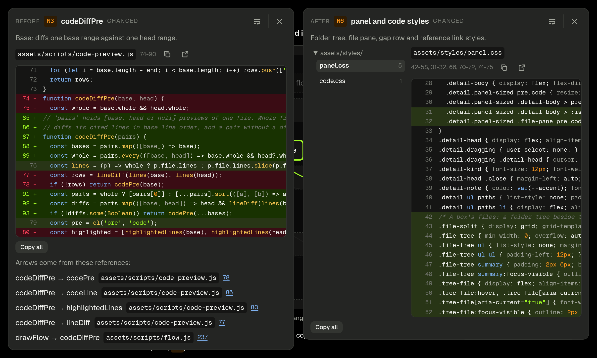
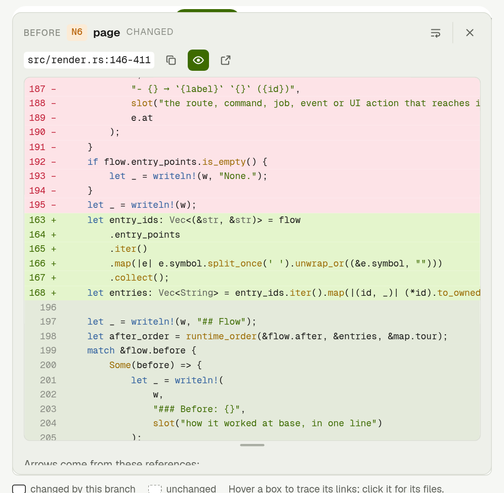
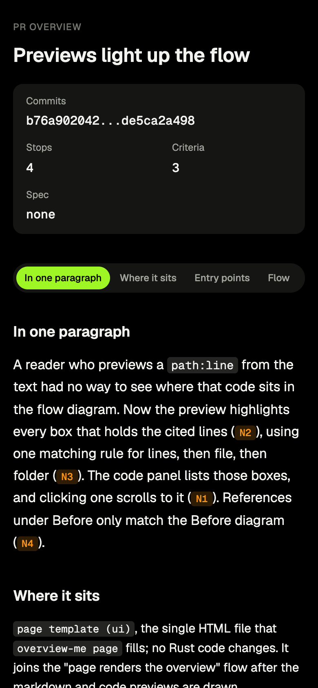

# Tutorial: read an overview

This tutorial walks through one real page: the PR overview of overview-me's own PR #40, which makes code previews light up the flow diagram. Every overview page works the same way.

## 1. Make an overview

In Claude Code, on the branch you want to understand, ask in plain words or run the command:

```
/overview-me:pr-overview
```

Use `/overview-me:change-overview` for uncommitted work, and `/overview-me:codebase-overview` for a map of the whole repo. In pi, the commands are `/skill:pr-overview`, `/skill:change-overview` and `/skill:codebase-overview`.

Claude runs the overview-me CLI, which reads git and the code and writes the page skeleton. Claude then fills in the parts that need judgment. In Claude Code the page opens as a private Claude artifact; in pi and other agents it opens as an HTML file in your browser.

## 2. Find your way

The header shows what the page covers: the commits it compares, the number of stops (pieces of changed code), the number of criteria and the spec it checked against.

On a wide screen, **On this page** on the left lists every section and marks the one you are reading. Click a name to jump to it. On a narrow screen the same list is a bar at the top.


## 3. Read the flow

The Flow section draws how the code ran before the change and how it runs now, side by side on a wide screen. Each box is a piece of code, in a lane. Draft lanes come from the folders of the change; the Label step renames them to what that part of the system is, such as `billing`, and may regroup them. Its `N1`-style chip is the stop's id, used everywhere on the page.

- A box with a solid border is changed by the branch, a green one is new, a red dashed one is removed, and a grey dashed one is unchanged code the change calls or is called by.
- Hover a box (or tab to it) to trace its links: its arrows and the boxes at their other end light up, and the rest fades.
- The numbered steps under each diagram follow the code in the order it runs.


## 4. Open a box

Click a box to open its panel. The Before flow opens a panel on the left; the After flow opens one on the right. Each title bar has a **Before** or **After** tag. You can keep both panels open. Opening another box replaces only that side's panel.

The panel shows the box's note, then its files: a folder tree on the left and the selected file's code on the right, like a pull request's file list. Each file appears once in the tree, with the number of ranges the box cites in it. The first file opens with the panel; click another file to show it. A box with one file shows only the code.

In a PR or change overview, the panel head has a **Show all changed files** button. It adds the change's other files to the tree, muted, so you can see where the box's files sit among everything the change touches. Folders that hold none of the box's files start closed, and each changed file shows its git status letter (`A`, `M`, `D`, `R`). When the commit is pushed, click a muted file to open it on the forge. The page remembers the choice for every box.

The code shows every cited range of the file in one view, scrolled to the cited lines, which are highlighted. A `⋯ N lines not embedded ⋯` row stands for the lines between two ranges. In a removed box the cited lines are red with a `−`; in an added box they are green with a `+`. The ranges beside the path are links: click one to scroll the code to its first line. Resize the panel to see more code. Drag the bar between the tree and the code to make the tree wider or narrower, or focus the bar and use the arrow keys. Double-click the bar to go back to the default width. The page remembers the width for every box. Above the code:

- The copy icon puts the file's path on your clipboard, ready for your editor's file search.
- The arrow icon opens the file's first range on GitHub at the commit the page describes.

In a Before box changed by the branch, the code is a unified diff of the base code against the head code. Removed lines are red, with a `−` and the base line number. Added lines are green, with a `+` and the head line number. If the page holds both whole files, the diff covers the whole file and scrolls to the cited lines. Otherwise it compares only the cited lines. If the head code is missing or the diff is too large, the panel shows plain base code.

Under the files, **Arrows come from these references** lists each arrow of the box with the files and lines of the imports or calls behind it. Click a line number to open that line's code under the reference, without leaving the file above; click it again to close it.





The wrap icon in the panel's title bar wraps long lines in every preview. The page remembers this choice.

Drag a panel by its title to move it, and drag any edge or corner to resize it. Each panel remembers its own size and place. Double-click the title to reset its place, or an edge to reset that dimension. Click a panel to bring it to the front.

Click the × icon or click the box again to close only its panel. Escape closes the panel that has focus. If focus is in neither panel, Escape closes both.

## 5. Preview code from the text

Every `path:line` in the text has an eye button next to it. Click it to open the file in a code panel, scrolled to the cited lines. A code link in a Before step opens in the Before panel. All other code links open in the After panel. Opening a link replaces only that side's panel.

The preview also finds that code in the flow. The boxes that hold those lines get a yellow ring, and the panel lists them under **In the flow**. Click one to scroll to its box. Click the eye again, or the × icon, to close the preview and clear the rings. The title bar also has a copy icon for the `path:line`, the wrap icon and an arrow icon that opens the lines on GitHub.

If the panel covers the box you are looking for, drag the panel aside or make it narrower.


## 6. Read findings on the flow

To add a code review to the overview, install the [OpenCodeReview](https://github.com/alibaba/open-code-review) `ocr` CLI. Then ask "show the bugs in this PR on the flow", or run:

```
/overview-me:ocr-overview
```

In pi, use `/skill:ocr-overview`. The skill uses OCR to review the same base and head as the overview, then places the findings on the page.

- In the After flow, a badge on a box counts its findings. Red counts critical and high findings, yellow counts medium, and grey counts low. Hover the badge for the severity counts.
- Click a box to read its findings in the panel, above its files. Each finding shows its severity, category, file and lines, and review text. The first finding's code opens with those lines highlighted; use the eye buttons to show or hide the code. Expand **Suggested code** when a finding includes a fix.
- The **Findings** section lists the findings on stops and those **Outside this change**. Its summary counts findings, critical or high findings, affected stops and rejected findings. The findings file gives the reasons for rejected findings.

The badges appear only on the After flow because findings refer to the head code. overview-me checks where each finding points, not whether it is correct.

## 7. Check the claims

The sections after the flow tell you what to trust and where to look:

- **Claims and proof** lists each criterion with the code that implements it and the tests that prove it. A green badge means implemented and proved by a test. A yellow one means untested, or partial when part of the logic lives outside the diff. A red one means missing. Each untested criterion also shows up under Open questions.
- **Read first** names the few places that hold the decisions. Everything else is listed under Skim.
- **Watch out** tags what is easy to miss: red for Breaking and Security, yellow for Migration, Race and Perf, orange for Subtle.
- **Open questions** lists what the code cannot answer, each with the `path:line` it is about.


## 8. Map a codebase

A codebase overview draws the whole repo as modules and how they call each other. It works like the flow: hover a module to trace it, click it for its folder and entry points. PR overviews use this map to say where a change sits.


## 9. Light, dark and phone

The page follows your system light or dark mode. The picker in the header switches the color palette (Default or Catppuccin, plus any you add with `--theme`); the page remembers your choice. On a phone, the sections bar sits at the top and panels open as a bottom sheet you can drag taller or shorter. Only one sheet shows at a time; opening either side closes the other.

| Light | Phone |
| --- | --- |
|  |  |
