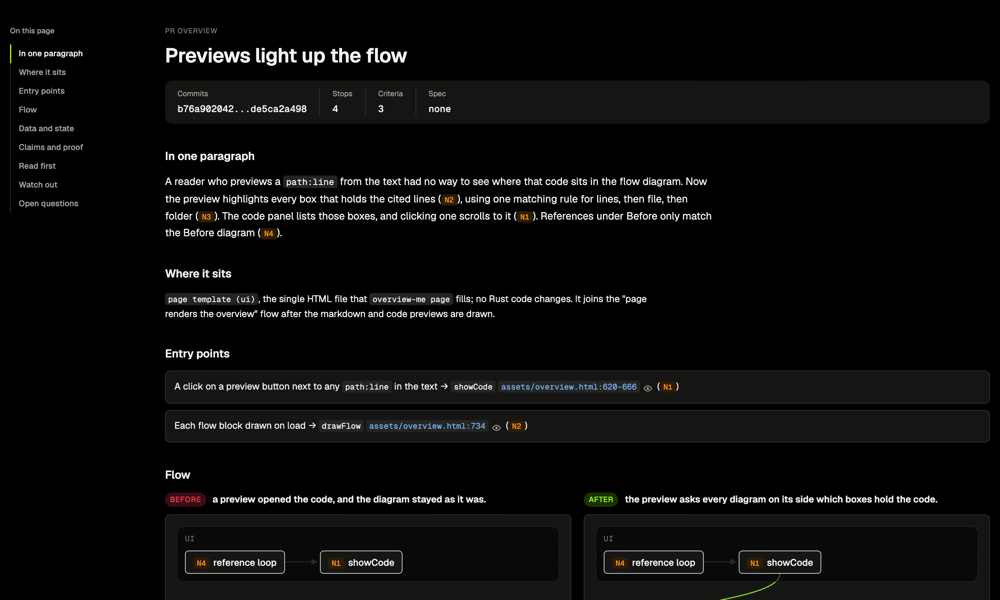
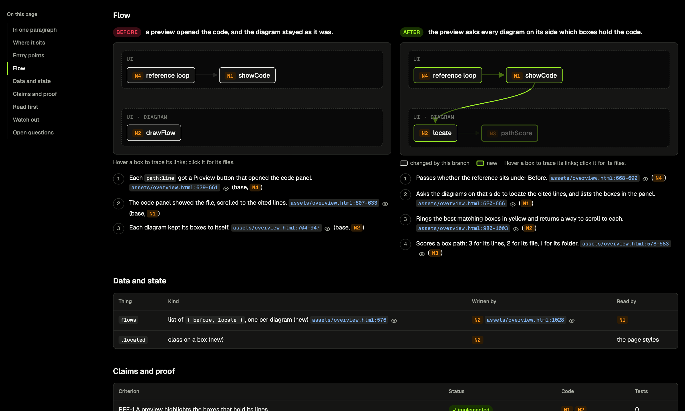
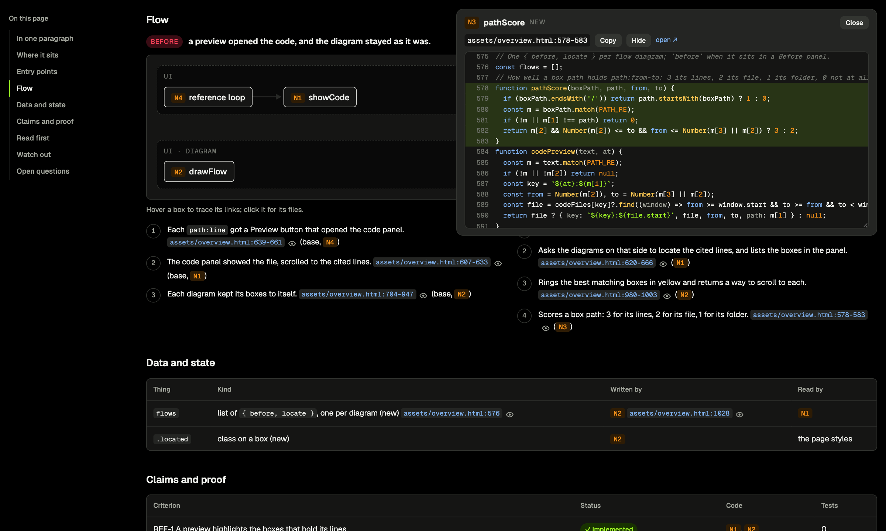
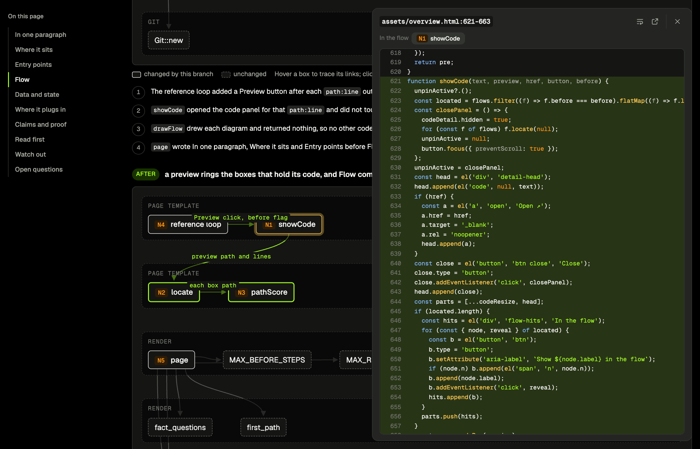
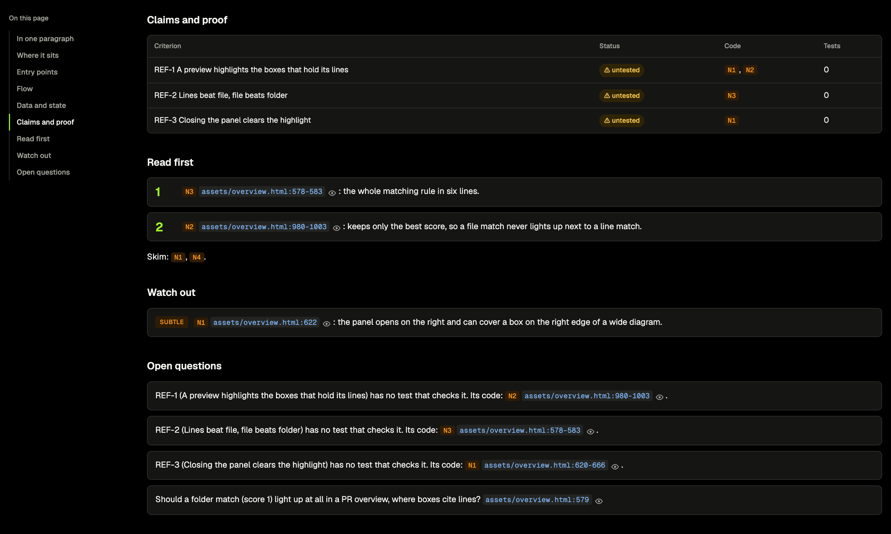
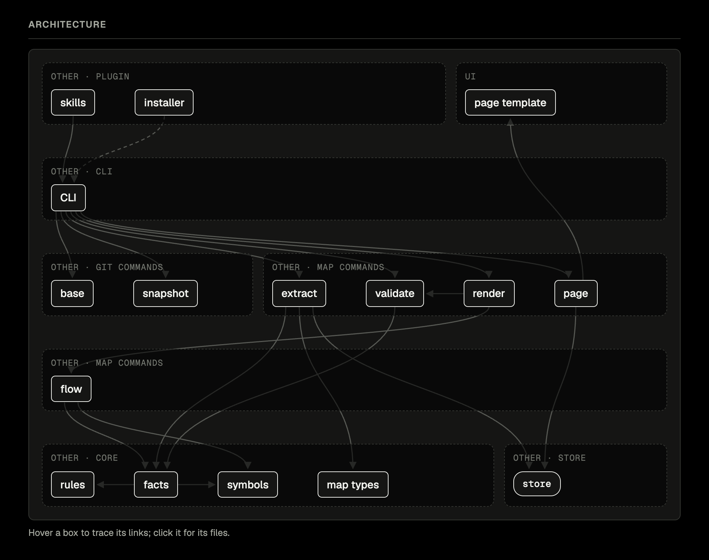
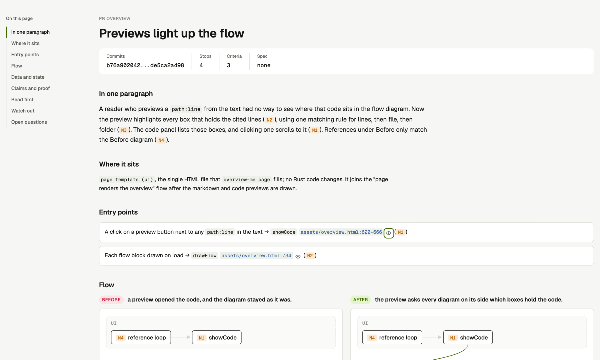

# Tutorial: read an overview

This tutorial walks through one real page: the PR overview of overview-me's own PR #40, which makes code previews light up the flow diagram. Every overview page works the same way.

## 1. Make an overview

In Claude Code, on the branch you want to understand, ask in plain words or run the command:

```
/overview-me:pr-overview
```

Use `/overview-me:change-overview` for uncommitted work, and `/overview-me:codebase-overview` for a map of the whole repo. In pi, the commands are `/skill:pr-overview`, `/skill:change-overview` and `/skill:codebase-overview`.

Claude runs the overview-me CLI, which reads git and the code and writes the page skeleton. Claude then fills in the parts that need judgment. In Claude Code the page opens as a private Claude artifact; in pi and other agents it opens as an HTML file in your browser.

## 2. Find your way

The header shows what the page covers: the commits it compares, the number of stops (pieces of changed code), the number of criteria and the spec it checked against.

On a wide screen, **On this page** on the left lists every section and marks the one you are reading. Click a name to jump to it. On a narrow screen the same list is a bar at the top.



## 3. Read the flow

The Flow section draws how the code ran before the change and how it runs now, side by side on a wide screen. Each box is a piece of code, in a lane: ui, api, services or db when a rule in `rules.json` matches, else the module's own name, such as `billing`. Its `N1`-style chip is the stop's id, used everywhere on the page.

- A box with a solid border is changed by the branch, a green one is new, a red dashed one is removed, and a grey dashed one is unchanged code the change calls or is called by.
- Hover a box (or tab to it) to trace its links: its arrows and the boxes at their other end light up, and the rest fades.
- The numbered steps under each diagram follow the code in the order it runs.



## 4. Open a box

Click a box to open its panel on the right. It shows the box's note and its files as `path:line`:

- **Copy** puts the path on your clipboard, ready for your editor's file search. **Copy all** copies every path.
- **Preview** shows the file inside the panel, scrolled to the cited lines, which are highlighted. **Hide** closes it.
- **open ↗** opens the lines on GitHub at the commit the page describes.

Drag the panel by its title to move it, and drag any edge or corner to resize it. Double-click the title or an edge to reset it. Press Escape or click the box again to close it.



## 5. Preview code from the text

Every `path:line` in the text has an eye button next to it. Click it to open the whole file in a code panel, scrolled to the cited lines.

The preview also finds that code in the flow. The boxes that hold those lines get a yellow ring, and the panel lists them under **In the flow**. Click one to scroll to its box. Click the eye again, or **Close**, to close the preview and clear the rings.

If the panel covers the box you are looking for, drag the panel aside or make it narrower.



## 6. Check the claims

The sections after the flow tell you what to trust and where to look:

- **Claims and proof** lists each criterion with the code that implements it and the tests that prove it. A green badge means implemented and proved by a test. A yellow one means untested, or partial when part of the logic lives outside the diff. A red one means missing. Each untested criterion also shows up under Open questions.
- **Read first** names the few places that hold the decisions. Everything else is listed under Skim.
- **Watch out** tags what is easy to miss: red for Breaking and Security, yellow for Migration, Race and Perf, orange for Subtle.
- **Open questions** lists what the code cannot answer, each with the `path:line` it is about.



## 7. Map a codebase

A codebase overview draws the whole repo as modules and how they call each other. It works like the flow: hover a module to trace it, click it for its folder and entry points. PR overviews use this map to say where a change sits.



## 8. Light, dark and phone

The page follows your system theme. On a phone, the sections bar sits at the top and panels open as a bottom sheet you can drag taller or shorter.

| Light | Phone |
| --- | --- |
|  |  |
